Version anglaise : [README.md](README.md)

# Listo

**Listo est une application de listes partagées (courses, tâches, idées de cadeaux), pensée pour le téléphone, que l'on installe sur son propre serveur.** Gratuite, sans publicité, en français et en anglais, pour une famille ou un petit groupe de proches.

## L'essentiel

- **Listes partagées en direct** : un article coché sur un téléphone l'est sur les autres en quelques secondes ; chaque personne a son droit, « Peut modifier » ou « Lecture seule » ; une seule entrée « Partager » partage une liste ou une note avec des personnes de Listo ou par un lien temporaire.
- **Trois types de liste** : courses (classées par rayon, ou par magasin pour une tournée), tâches (priorité, échéance, répétition, attribution) et envies (réservation et cotisation, sans que la personne gâtée ne le sache ; une liste « À offrir » réunit d'elle-même les cadeaux que vous avez réservés, avec une case « Acheté » que vous seul voyez).
- **Saisie rapide** : plusieurs articles d'un coup, quantité lue dans le nom, scan du code-barres, photos.
- **Accueil, notes et hors ligne** : Listo s'ouvre sur des tuiles qui montrent d'un coup d'œil les échéances (en retard, aujourd'hui, plus tard), vos listes par type, vos cadeaux à acheter, vos dernières notes et votre compte (chacun choisit les tuiles affichées et leur ordre, ou coupe l'Accueil et choisit son premier écran) ; les notes sont des textes libres qui s'enregistrent tout seuls, avec une mise en forme simple (titres, gras, listes, cases à cocher, liens, par une barre de boutons au-dessus du clavier), des liens cliquables, une épingle, des étiquettes de couleur communes à tout le foyer (pour les ranger et les filtrer ; seul l'Admin renomme ou supprime une étiquette) et leur corbeille, partagées comme les listes (« Peut modifier » ou « Lecture seule », nouveautés, notifications) ou par un lien public en lecture seule (deux personnes ou deux appareils qui écrivent en même temps ne s'écrasent jamais : vous choisissez la version à garder), et qui ne s'en sert pas les coupe pour lui seul dans Réglages › Fonctions, sans rien effacer ; il s'ouvre et s'utilise sans réseau, et tout part au retour du réseau.
- **Sur ordinateur** (fenêtre d'au moins 1 024 px) : deux zones (menu de gauche qui suit l'écran, liste ouverte), fiche dans un panneau, partage dans une fenêtre au centre, raccourcis clavier (« ? » les liste, désactivables) et Ctrl+Z pour annuler une suppression, un cochage ou une modification. Sur le téléphone, rien ne change. **Projets** (coupés au départ, allumés par chacun dans Réglages › Fonctions) : des tableaux de cartes rangées en colonnes de couleur (idées, en cours, fait…), partagés avec les personnes de Listo selon quatre rôles (propriétaire, peut modifier, contributeur, lecture seule), une colonne à la fois sur le téléphone et sur toute la largeur sur ordinateur, avec le glisser-déposer, hors ligne compris.
- **Lien public** pour montrer une liste ou une note à quelqu'un sans compte, **corbeille** de 30 jours ; les **assistants IA** qui suivent le standard MCP (par exemple Claude, d'Anthropic) peuvent lire vos listes et vos notes et, si vous le permettez, y écrire (ajouter des éléments, les cocher, créer ou compléter une note, poser ses étiquettes), avec deux niveaux d'accord, toujours après votre accord sur un écran « Autoriser un assistant IA », et sans jamais rien effacer pour de bon (une note ne peut aller qu'à la corbeille).
- **Notifications** : modifications des autres (regroupées, et tâches qu'on vous attribue), réservations, partage, résumé des échéances chaque matin et rappels des tâches, gardés 30 jours dans la **page Notifications** (la cloche de l'Accueil, lu ou non lu, pareil sur tous les appareils, même sans notifications push) ; et, facultatives et désactivées par défaut, sur le téléphone ou l'ordinateur en notifications push.
- **Sécurité** : double authentification, sauvegarde chaque nuit, droits vérifiés par le serveur. **Un seul guide numéroté**, le même dans l'application (Réglages › Aide), en ligne sur **<https://magicgg91.github.io/listo/fr/>** et dans le dépôt : [docs/guide.md](docs/guide.md).

## En images

|  | 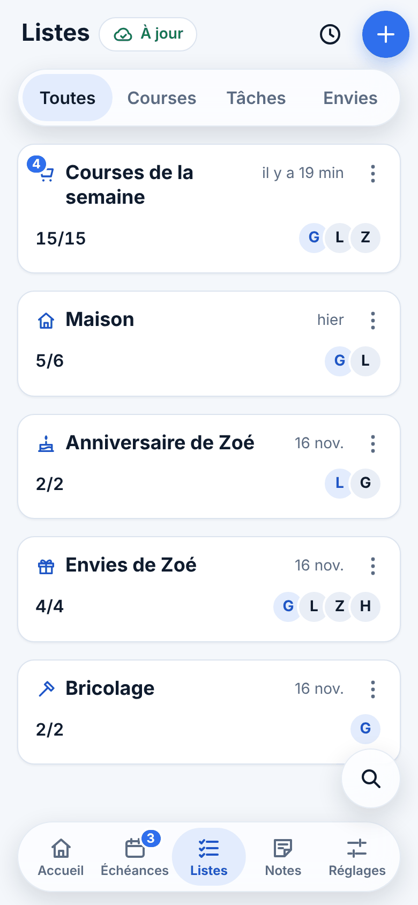 | 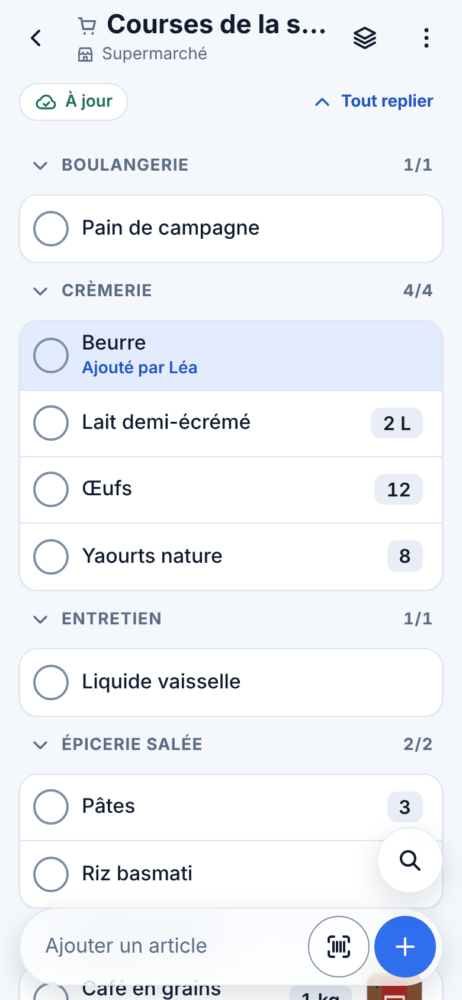 | 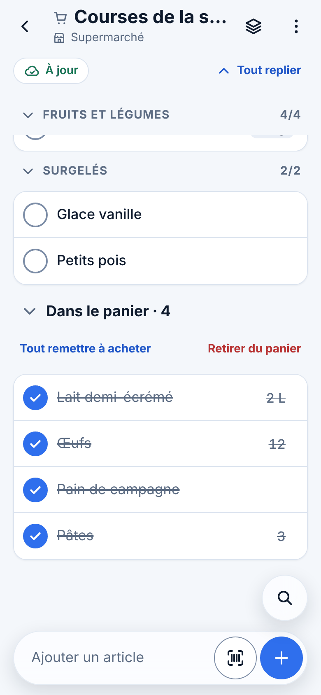 | 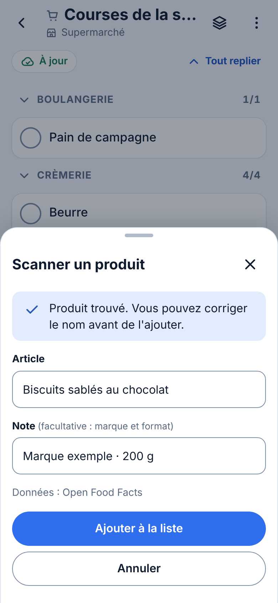 |
| :---: | :---: | :---: | :---: | :---: |
| Accueil | Listes | Courses par rayon | « Dans le panier » | Mode scan |
| 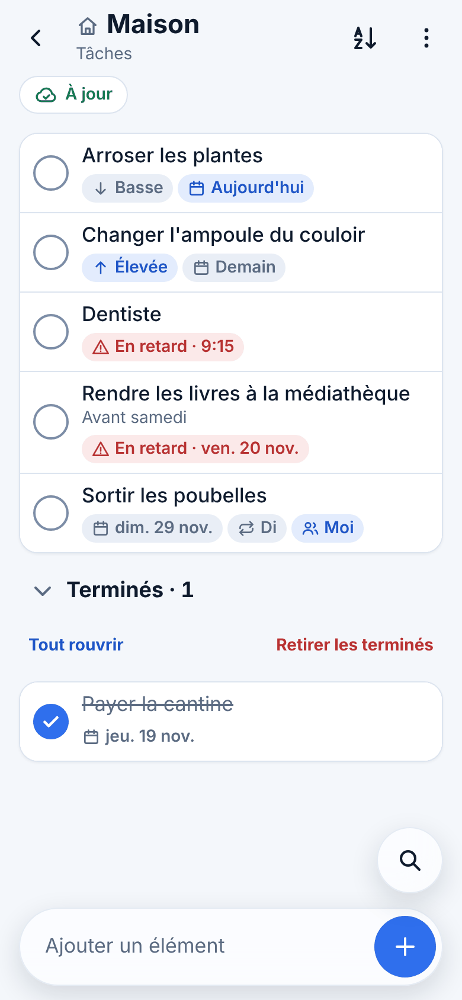 | 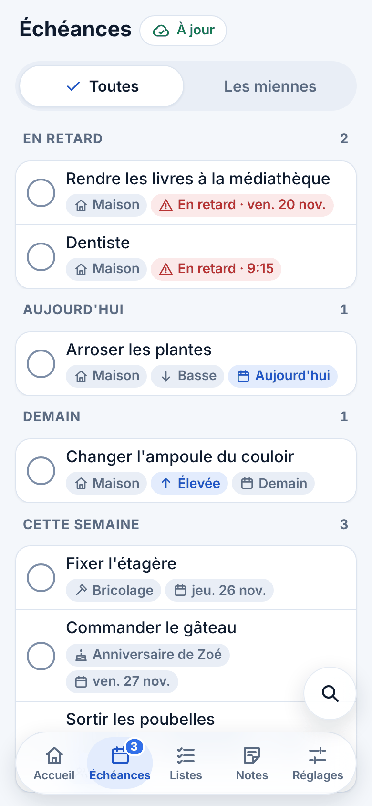 | 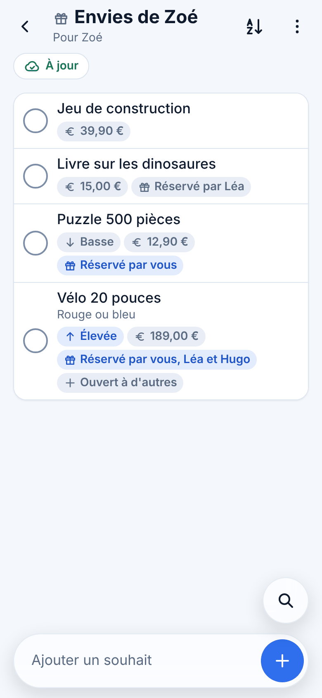 | 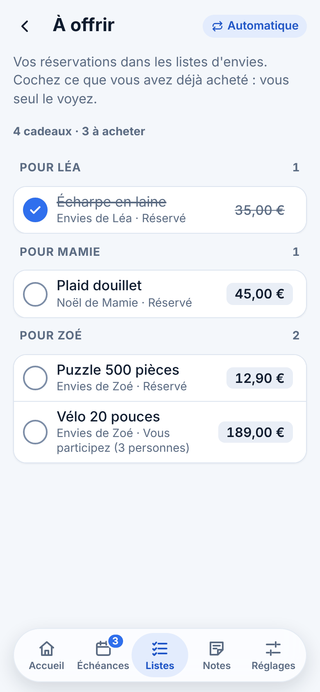 |  |
| Tâches | « Échéances » | Envies, réservations | « À offrir » | Notes |
| 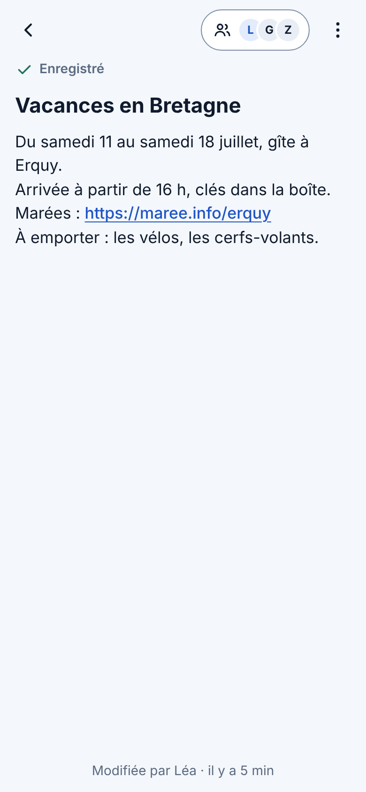 | 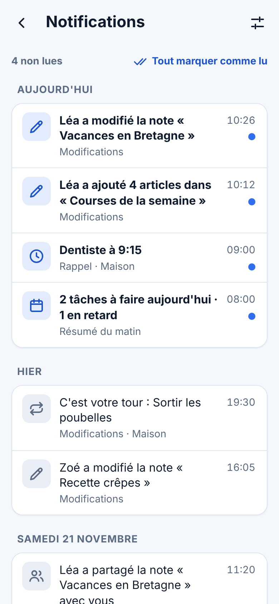 | 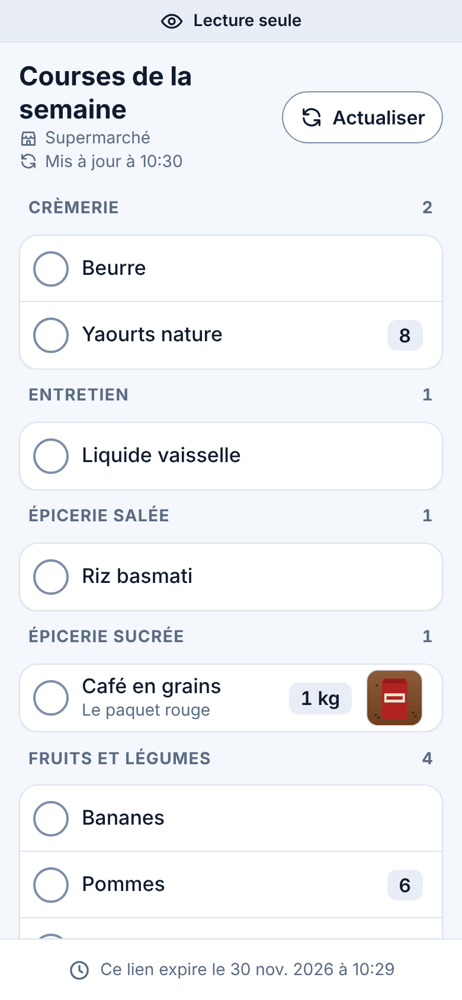 | 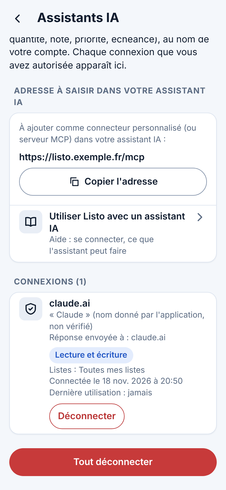 | 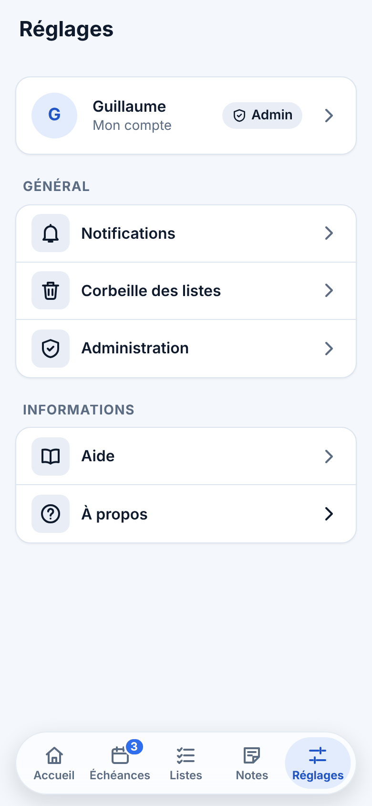 |
| Note partagée | Notifications | Lien public | « Assistants IA » | Réglages |

*Instance de démonstration, données inventées, compte en français.*

## Installation en trois commandes

Il faut un serveur Linux avec Docker, un nom de domaine, et un proxy inverse HTTPS, peu importe lequel (Nginx Proxy Manager, Caddy, Traefik, nginx, Apache…).

```sh
mkdir -p /opt/listo && cd /opt/listo     # puis y copier docker-compose.yml et le régler
docker compose up -d                     # télécharge et démarre Listo
docker logs listo                        # affiche le code de démarrage du premier Admin
```

Le pas à pas complet (réglages, ce que doit faire le proxy avec un exemple pour Nginx Proxy Manager, clé secrète, vérifications) est dans le guide, [chapitre Installation](docs/guide.md#installation). Sauvegardes : [guide](docs/guide.md#sauvegardes). Restauration, mises à jour et dépannage du serveur : le guide d'exploitation, [docs/exploitation.md](docs/exploitation.md).

## Limites

- **Aucune donnée envoyée ailleurs que sur votre serveur**, sauf trois exceptions désactivables : la vérification d'une nouvelle version (GitHub), le nom d'un produit scanné (Open Food Facts) et les **notifications push**, désactivées par défaut (`LISTO_PUSH=on` les active ; contenu chiffré de bout en bout, mais Apple, Google, Mozilla ou Microsoft voient l'heure, la taille du message et l'appareil destinataire). Si vous connectez un assistant IA comme Claude (`LISTO_MCP=on` ; `LISTO_MCP_SITES` peut limiter les sites d'assistants acceptés), les listes et les notes autorisées lui sont envoyées quand vous l'interrogez. Connexion facultative par votre propre fournisseur d'identité OpenID Connect, par exemple Authelia, Authentik ou Pocket ID (`LISTO_OIDC=on`, [guide](docs/guide.md#sso-serveur)). En français et en anglais, pas de paiement ; notifications sur iPhone et iPad : iOS 16.4 ou plus, Listo installé sur l'écran d'accueil ([chapitre Notifications](docs/guide.md#notifications)).

## Liens utiles

- [Le guide en ligne](https://magicgg91.github.io/listo/fr/), ou [docs/guide.md](docs/guide.md) dans le dépôt : pour tout le monde.
- [docs/cahier-des-charges.md](docs/cahier-des-charges.md) : fonctions, droits, modèle de données, sécurité, décisions.
- [docs/developpement.md](docs/developpement.md) : organisation du code, tests, vérifications sur les téléphones ; [docs/mcp-cadrage.md](docs/mcp-cadrage.md) : la conception de l'accès des assistants IA (MCP) ; [design/README.md](design/README.md) : le kit de design.

## Sécurité

Le port de Listo n'est publié que sur le réseau local ; seul le proxy HTTPS doit pouvoir le joindre. Mots de passe hachés, cookies protégés, blocage après 5 essais, politique de sécurité du contenu stricte. Signaler une faille, en privé : [SECURITY.md](SECURITY.md).

## Licence et crédits

- Licence **Apache-2.0**, © magicgg91 : [LICENSE](LICENSE). En cas de réutilisation, conserver [NOTICE](NOTICE) et la mention de l'auteur. Contribuer : [CONTRIBUTING.md](CONTRIBUTING.md).
- Lecteur de codes-barres : [zxing-wasm](https://github.com/Sec-ant/zxing-wasm) (MIT et Apache-2.0). Noms des produits : [Open Food Facts](https://world.openfoodfacts.org) (ODbL). Développé avec l'aide de Claude (Anthropic).
