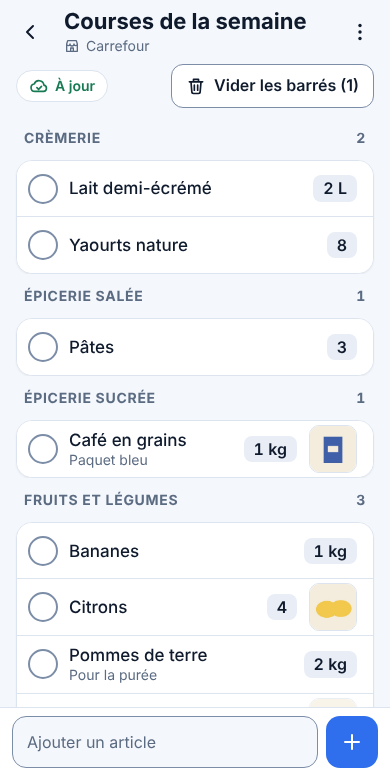
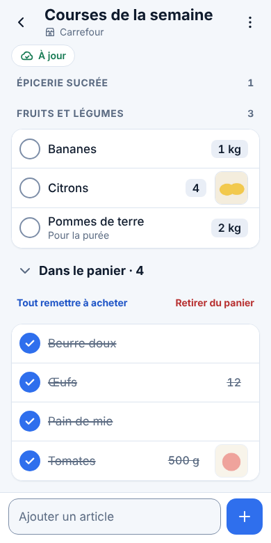
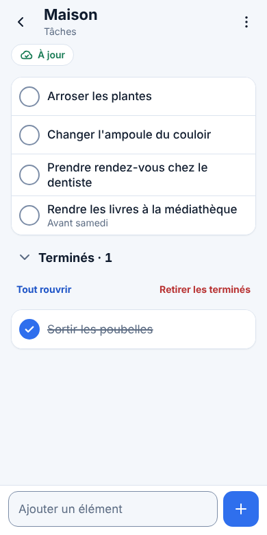
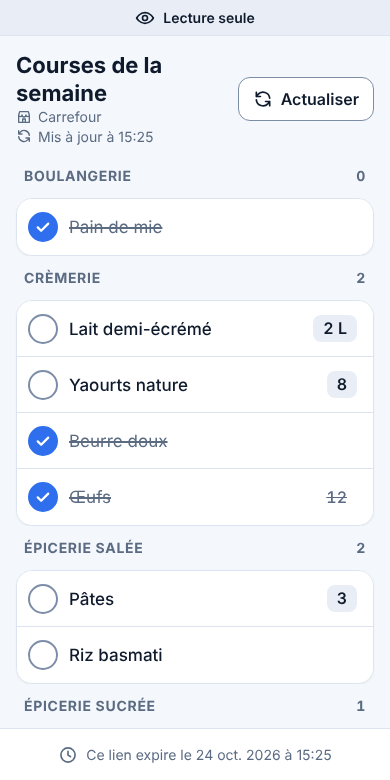
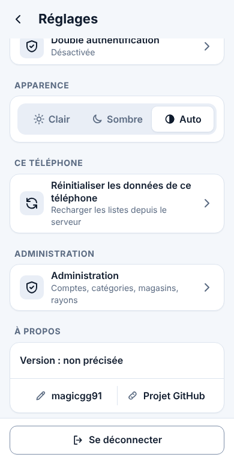

# Listo

**Listo est une application web de listes partagées (courses, tâches…), pensée pour le téléphone, que l'on installe sur son propre serveur.**

## Ce que fait Listo

- **Listes partagées en direct** : un article coché sur un téléphone l'est sur l'autre en quelques secondes ; les articles cochés se rangent « Dans le panier », en bas de la liste.
- **Courses classées par rayon**, ou **par magasin** pour une tournée de plusieurs magasins ; rayon habituel retenu, autocomplétion.
- **Photos** des articles, réduites sur le téléphone avant l'envoi.
- **Hors ligne** : Listo s'ouvre et s'utilise sans réseau ; tout part au retour du réseau.
- **Lien public en lecture seule** pour montrer une liste à quelqu'un sans compte (durée limitée, mot de passe facultatif).
- **Double authentification**, **sauvegarde chaque nuit**, thèmes clair et sombre, installation sur l'écran d'accueil.

## Pour qui, et limites

- Pour un foyer ou un petit groupe : quelques comptes, créés par l'administrateur. Pas d'inscription publique.
- Auto-hébergé : un conteneur Docker sur votre serveur, derrière un proxy HTTPS. Il n'existe pas de version en ligne.
- Interface en français uniquement. Aucune publicité, aucun suivi, aucune donnée envoyée ailleurs que sur votre serveur. Seule exception, que l'on peut couper : le serveur demande à GitHub, au plus une fois par heure, s'il existe une nouvelle version ([chapitre 9](docs/exploitation.md#savoir-quune-nouvelle-version-existe)).

## En images

|  |  |  |
| :---: | :---: | :---: |
| Mes listes | Courses classées par rayon | Articles cochés : « Dans le panier » |
|  |  |  |
| Liste de tâches | Lien public, en lecture seule | Réglages et « À propos » |

*Instance de démonstration, avec des données inventées.*

## Installation

Prérequis :
- un serveur Linux toujours allumé, avec **Docker** et **Docker Compose** ;
- un **proxy HTTPS**, par exemple Nginx Proxy Manager (il peut être sur une autre machine) ;
- un **nom de domaine** (par exemple `listo.mondomaine.fr`) qui pointe vers ce proxy.

1. **Créer le dossier de Listo**, avec `data/` (base, sauvegardes, photos) et `secrets/` (clé de chiffrement) :
   ```sh
   mkdir -p /opt/listo/data /opt/listo/secrets && cd /opt/listo
   ```
2. **Créer `/opt/listo/docker-compose.yml`** en remplaçant l'adresse publique et l'adresse du serveur sur le réseau local (le [`docker-compose.yml`](docker-compose.yml) du dépôt est le même fichier, commenté ligne par ligne) :
   ```yaml
   services:
     listo:
       image: ghcr.io/magicgg91/listo:latest
       container_name: listo
       restart: unless-stopped
       environment:
         - PORT=13300
         - TZ=Europe/Paris
         - LISTO_PUBLIC_URL=https://listo.mondomaine.fr   # l'adresse exacte, en https
       ports:
         - "192.168.1.20:13300:13300"   # adresse du serveur sur le réseau local, jamais 0.0.0.0
       volumes:
         - ./data:/data
         - ./secrets:/secrets
   ```
3. **Nginx Proxy Manager** : *Proxy Host* avec votre domaine, schéma `http`, l'adresse du serveur et le port `13300`. Onglet SSL : certificat Let's Encrypt, *Force SSL*, *HSTS*. *Websockets Support* n'est pas nécessaire : le temps réel (`/api/events`) passe par une connexion HTTP ordinaire, qu'il ne faut ni mettre en cache ni retenir. Onglet *Advanced* :
   ```nginx
   client_max_body_size 5m;
   proxy_buffering off;
   proxy_cache off;
   proxy_read_timeout 3600s;
   ```
4. **Première connexion** : démarrer Listo et lire le code de démarrage (encadré de `====`), puis ouvrir `https://listo.mondomaine.fr` et créer le compte Admin avec ce code.
   ```sh
   docker compose up -d && docker compose logs listo
   ```
5. **Double authentification** (conseillée pour l'Admin) : Réglages → Double authentification, scanner le QR code, puis garder les 10 codes de secours dans un gestionnaire de mots de passe.
6. **Sur le téléphone** : iPhone (Safari) → Partager → *Sur l'écran d'accueil* ; Android (Chrome) → menu ⋮ → *Installer l'application*.

Sécurité :
- Le port 13300 n'est publié que sur l'adresse du réseau local du serveur, et seul le proxy doit pouvoir le joindre.
- Copier tout de suite le contenu de `secrets/secret.key` (`cat secrets/secret.key`) dans un gestionnaire de mots de passe : sans lui, les doubles authentifications sont perdues après une panne.
- Ne jamais exposer le port 13300 directement sur Internet : toujours passer par le proxy HTTPS.

Le guide complet, pas à pas (pare-feu, variables, vérifications) : [docs/exploitation.md](docs/exploitation.md).

## Exploitation

- **Sauvegardes** : chaque nuit vers 3 h dans `data/backups/`, les 14 dernières gardées ; à la demande : `docker exec -u node listo node server/backup-now.js`. Sauvegarder aussi le dossier `data/` entier (photos, journal) avec le serveur.
- **Restauration** : arrêter Listo, remettre une copie de `data/backups/` à la place de `data/listo.db` avec la même clé `secrets/secret.key`, puis redémarrer.
  Pas à pas : [chapitre 8](docs/exploitation.md#8-restaurer-une-sauvegarde).
- **Mise à jour** : `docker compose pull && docker compose up -d` ; relire et fusionner les pull requests de Dependabot, qui signalent les mises à jour de sécurité ([chapitre 9](docs/exploitation.md#9-mettre-à-jour-listo)).
- **Journaux** : `docker compose logs -f listo` ; le journal de sécurité est aussi gardé dans `data/journal.log` ([chapitre 10](docs/exploitation.md#10-journaux)).
- **Compte Admin perdu** : `docker exec -u node listo node server/admin-secours.js IDENTIFIANT` donne un mot de passe provisoire (ajouter `--retirer-2fa` si la double authentification est inutilisable).
- **Santé** : `https://listo.mondomaine.fr/healthz` doit répondre `{"status":"ok"}`.
- **Version installée** : Réglages › À propos ; l'Admin y voit aussi si une nouvelle version existe (bouton « Vérifier »).
- **Version de Node** : jamais changée automatiquement ; à la main, et seulement vers une version paire (24, 26…) ([chapitre 9](docs/exploitation.md#surveiller-les-mises-à-jour-de-sécurité)).
- **Autres problèmes** (clé perdue, écran blanc, « origine inconnue »…) : [chapitre 11](docs/exploitation.md#11-en-cas-de-problème).

Pour les développeurs (organisation du code, tests, API) : [docs/developpement.md](docs/developpement.md).

## Licence et crédits

- Licence **Apache-2.0**, © magicgg91 : [LICENSE](LICENSE). En cas de réutilisation, conserver le fichier [NOTICE](NOTICE) et la mention de l'auteur.
- Contribuer : [CONTRIBUTING.md](CONTRIBUTING.md). Signaler une faille de sécurité, en privé : [SECURITY.md](SECURITY.md).
- Image Docker : `ghcr.io/magicgg91/listo`.
- Développé avec l'aide de Claude (Anthropic).
