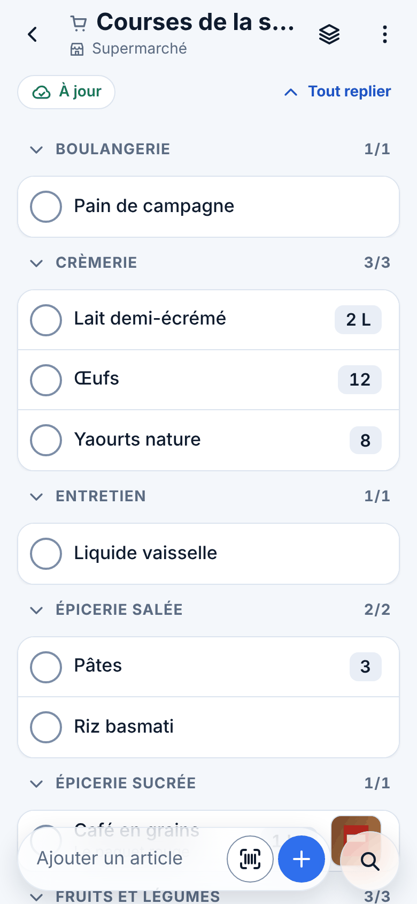
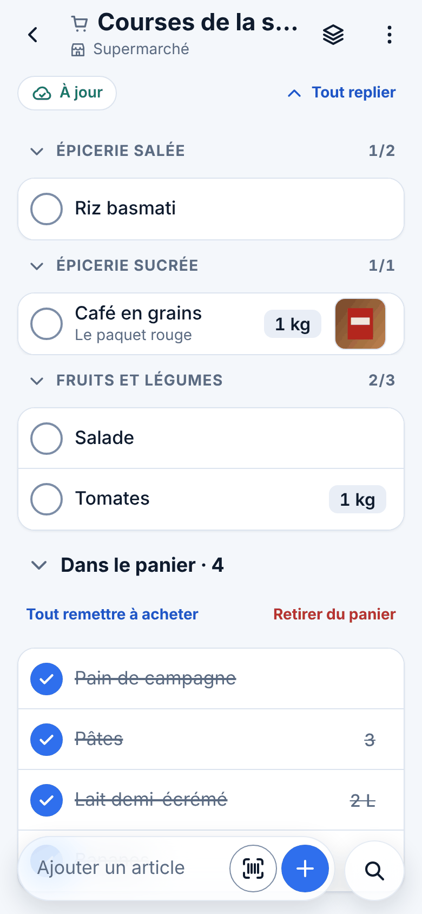
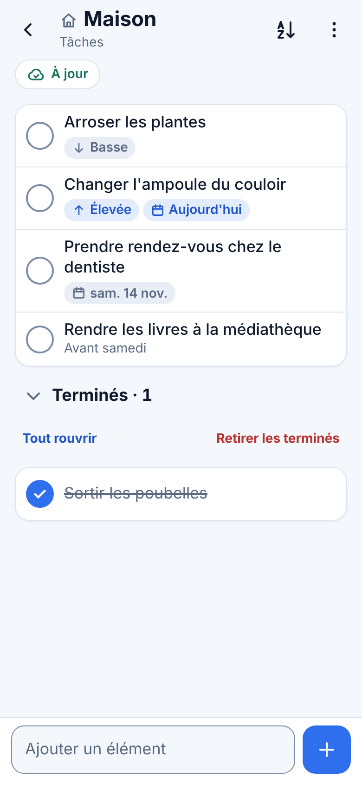
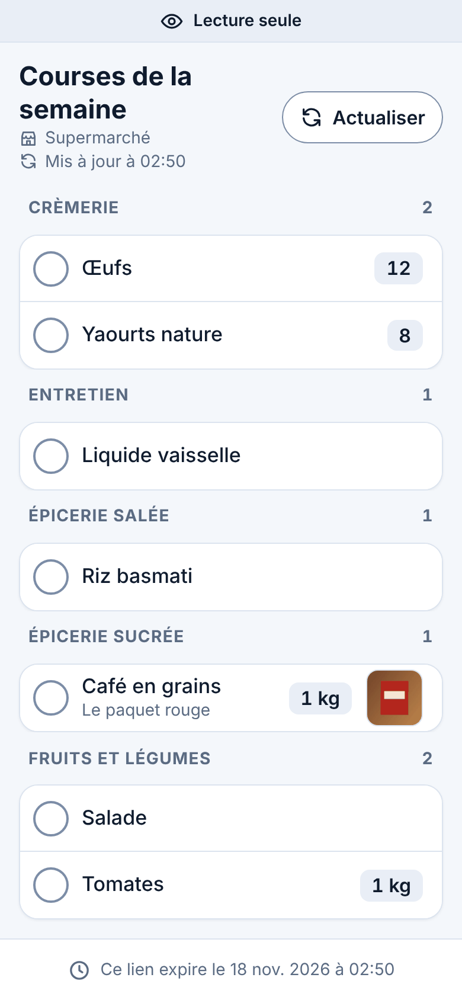
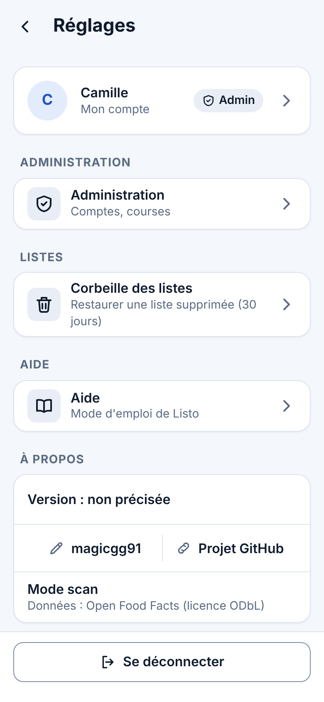

# Listo

**Listo est une application de listes partagées (courses, tâches, idées de cadeaux), pensée pour le téléphone, que l'on installe sur son propre serveur.** Gratuite, sans publicité, en français, pour une famille ou un petit groupe de proches.

## L'essentiel

- **Listes partagées en direct** : un article coché sur un téléphone l'est sur les autres en quelques secondes ; chaque personne a son droit, « Peut modifier » ou « Lecture seule ».
- **Trois types de liste** : courses (classées par rayon, ou par magasin pour une tournée), tâches (priorité, échéance) et envies (réservation et cotisation, sans que la personne gâtée ne le sache).
- **Saisie rapide** : plusieurs articles d'un coup, quantité lue dans le nom, scan du code-barres, photos.
- **Hors ligne** : Listo s'ouvre et s'utilise sans réseau ; tout part au retour du réseau.
- **Lien public** pour montrer une liste à quelqu'un sans compte, et **corbeille** de 30 jours.
- **Claude** (Anthropic) peut lire vos listes et, si vous le permettez, y écrire, avec deux niveaux d'accord et sans jamais rien supprimer.
- **Sécurité** : double authentification, sauvegarde chaque nuit, droits vérifiés par le serveur.
- **Un seul guide numéroté**, le même dans l'application (Réglages › Aide), en ligne sur **<https://magicgg91.github.io/listo/>** et dans le dépôt : [docs/guide.md](docs/guide.md).

## En images

|  |  |  |
| :---: | :---: | :---: |
| Mes listes | Courses classées par rayon | « Dans le panier » |
|  |  |  |
| Tâches : priorité, échéance | Envies : réservation, cotisation | Mode scan |
|  |  |  |
| Lien public, sans compte | « Connexions Claude » | Réglages |

*Instance de démonstration, données inventées.*

## Installation en trois commandes

Il faut un serveur Linux avec Docker, et un proxy HTTPS (Nginx Proxy Manager) avec un nom de domaine.

```sh
mkdir -p /opt/listo && cd /opt/listo     # puis y copier docker-compose.yml et le régler
docker compose up -d                     # télécharge et démarre Listo
docker logs listo                        # affiche le code de démarrage du premier Admin
```

Le pas à pas complet (réglages, Nginx Proxy Manager, clé secrète, vérifications) est dans le guide, [chapitre Installation](docs/guide.md#installation). Mises à jour, sauvegardes et dépannage : [Gérer le serveur](docs/guide.md#serveur).

## Liens utiles

- [Le guide en ligne](https://magicgg91.github.io/listo/), ou [docs/guide.md](docs/guide.md) dans le dépôt : pour tout le monde.
- [docs/cahier-des-charges.md](docs/cahier-des-charges.md) : fonctions, droits, modèle de données, sécurité, décisions.
- [docs/developpement.md](docs/developpement.md) : organisation du code, tests, vérifications sur les téléphones.
- [docs/mcp-cadrage.md](docs/mcp-cadrage.md) : la conception de l'accès depuis Claude.
- [design/README.md](design/README.md) : le kit de design.

## Sécurité

Le port de Listo n'est publié que sur le réseau local ; seul le proxy HTTPS doit pouvoir le joindre. Mots de passe hachés, cookies protégés, blocage après 5 essais, politique de sécurité du contenu stricte. Signaler une faille, en privé : [SECURITY.md](SECURITY.md).

## Licence et crédits

- Licence **Apache-2.0**, © magicgg91 : [LICENSE](LICENSE). En cas de réutilisation, conserver [NOTICE](NOTICE) et la mention de l'auteur. Contribuer : [CONTRIBUTING.md](CONTRIBUTING.md).
- Lecteur de codes-barres : [zxing-wasm](https://github.com/Sec-ant/zxing-wasm) (MIT et Apache-2.0). Noms des produits : [Open Food Facts](https://world.openfoodfacts.org) (ODbL).
- Développé avec l'aide de Claude (Anthropic).
